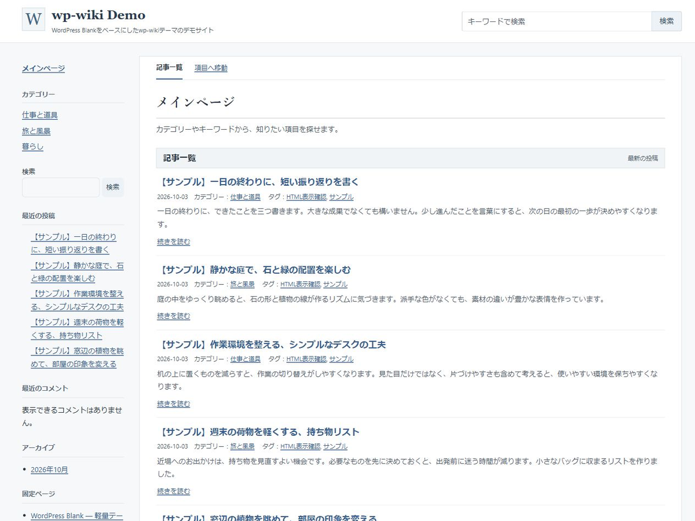

# wp-wiki

日本語向けの軽量なWiki風WordPressテーマ。**Version 1.0.7**。

[紹介・ダウンロード](https://kwdig.com/wp-wiki) · [デモサイト](https://kwdig.com/wp-wiki/demo/)

## 主な機能

- 左サイドバーの階層付きカテゴリーと、白い本文パネル
- コンパクトな記事一覧、カテゴリー・タグの表示
- 同じカテゴリー・タグをもとにした関連記事（最大5件）
- ヘッダー・サイドバー検索、モバイルのカテゴリー開閉
- 色だけに依存しないリンク表示とキーボードフォーカス
- ウィジェット、固定ページ、コメント、ページネーション

## インストール

1. [インストール用ZIP](https://github.com/kwdig/wp-wiki/raw/refs/heads/main/wp-wiki.zip)をダウンロード。
2. WordPressの「外観 → テーマ → 新しいテーマを追加 → テーマのアップロード」でZIPを選択。
3. wp-wikiを有効化し、サイト名・カテゴリー・ウィジェットを設定。

マルチサイトではネットワーク管理からアップロードして有効化してください。GitHubの「Code → Download ZIP」はリポジトリ全体のZIPです。テーマのインストールには上記の **wp-wiki.zip** を使用してください。

## 動作要件

WordPress 6.0以上 / PHP 7.4以上。クラシックテーマ（ブロックエディター対応）。デモ記事・画像やサイト固有設定は含みません。

## 表示速度

デモサイトの1.0.5を2026年10月20日にPageSpeed Insightsで測定し、モバイル・デスクトップともにパフォーマンス・ユーザー補助・おすすめの方法・SEOで100点を記録しました。測定時点の結果であり、コンテンツ・設定・サーバー環境により変動します。詳細は[紹介記事](https://kwdig.com/wp-wiki)を参照してください。

## 更新履歴

- **1.0.7**: テーマ選択画面用スクリーンショットを最新デザインで確認・更新。

- **1.0.6**: テーマ選択画面用スクリーンショットを最新デザインへ更新。
- **1.0.5**: テーマ選択画面用スクリーンショットを更新。
- **1.0.4**: フッターを「Theme by KwDig」、リンク先をkwdig.comへ変更。
- **1.0.3**: 記事詳細の前後記事ナビゲーションを削除。
- **1.0.2**: リンクの識別性を改善。
- **1.0.1**: レイアウトのずれ・文字のコントラスト・不要な画像転送を改善。
- **1.0.0**: WordPress Blank 1.2.3をベースにWiki風テーマを作成。

## ライセンスとクレジット

GPL-2.0-or-later。WordPress Blank 1.2.3（KWMine）をベースにKwDigがカスタマイズしました。既存ファイルのライセンス表記を維持しています。詳細な設定・過去の変更点は[README.txt](README.txt)を参照してください。
